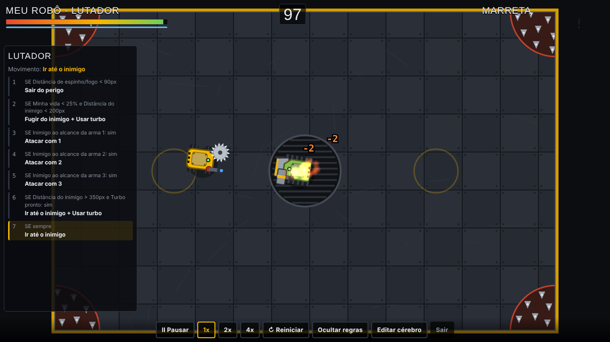
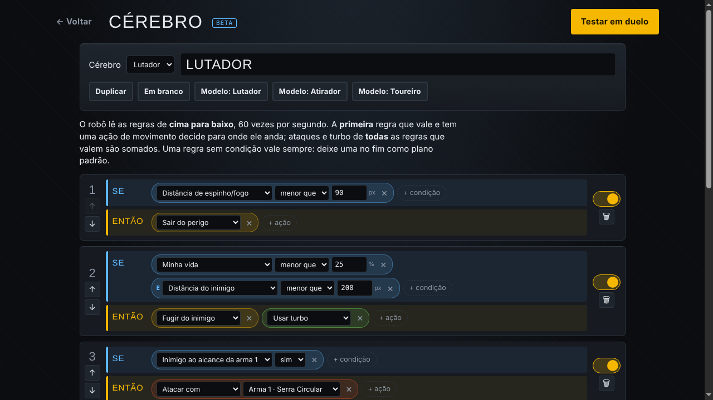
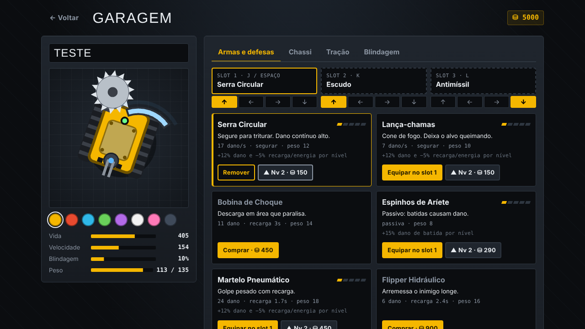
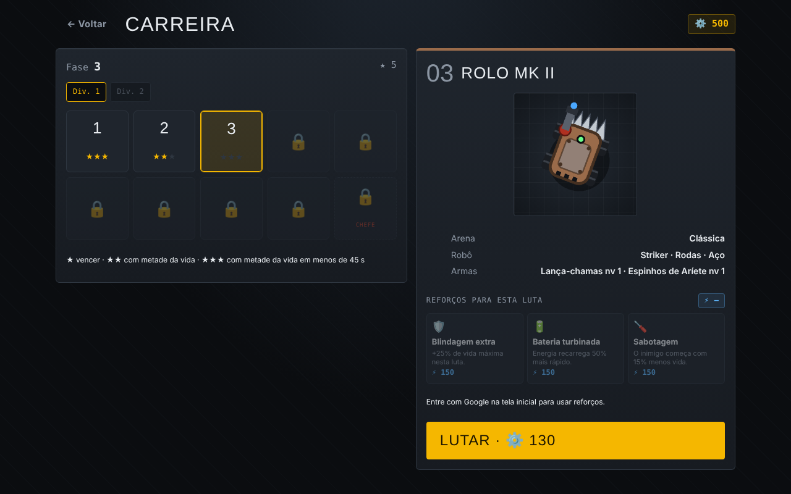

# 🤖 Robot Warriors — Engine

**Motor de simulação e cérebro programável do [Robot Warriors](https://www.robotwarriors.app)**, um jogo de luta de robôs em que você monta o seu robô peça por peça e programa como ele luta.

> 🎮 **Jogue:** [robotwarriors.app](https://www.robotwarriors.app)
>
> Este repositório é uma **vitrine de código**: traz o núcleo do jogo (física, armas e defesas, arenas, IA, o interpretador do cérebro em blocos e o gerador de fases da Carreira). A interface, o áudio, a loja e o backend ficam no repositório principal, que é privado.



---


## Atualização do jogo — novembro de 2026

A versão publicada do [Robot Warriors](https://www.robotwarriors.app) evoluiu além do snapshot de código deste repositório. O jogo principal agora inclui:

- **Firmware modular** de direção, ataque e defesa, com níveis de inteligência e orçamento de processamento (CPU).
- **Arenas dinâmicas** com minas, zonas elétricas, fossos, campos temporais, portais, paredes móveis e estações de suporte.
- **Navegação mais segura** para robôs autônomos, incluindo avaliação de trajetória, impulso e desvios diante de obstáculos e fossos.
- **Novos testes** para hazards, firmware, fuga, desvios, progressão e encerramento de partidas.

> **Transparência:** este repositório é uma vitrine independente, **não um espelho automático** do código privado de produção. As funcionalidades acima descrevem o jogo atual; o código correspondente ainda precisa ser selecionado, adaptado e testado antes de ser publicado aqui. Os exemplos e testes existentes neste repositório continuam representando seu snapshot próprio. Nenhum backend, credencial ou integração de pagamentos faz parte desta vitrine.

## A ideia

No Robot Warriors você não controla o robô na mão: você **programa o cérebro dele** com regras visuais do tipo *SE … ENTÃO …*, e ele luta sozinho contra outros robôs (IA contra IA).



O robô lê as regras **de cima para baixo, 60 vezes por segundo**:
- a primeira regra válida que tem uma ação de movimento decide para onde ele anda;
- ataques e turbo de **todas** as regras válidas são somados;
- uma regra sem condição vale sempre e serve de plano padrão.

**29 sensores** (distância, ângulo e lado do inimigo, vida, energia, parede, espinho/fogo, linha de visão, alcance e integridade de cada arma, míssil vindo, mina no chão, inimigo com escudo, "estou desnorteado"…) e **13 ações** (ir até, fugir, circular, manter distância, sair do perigo, mirar com a frente ou com uma arma específica, atacar, turbo, consertar, ligar escudo, soltar fumaça…).

## Montagem: armas em qualquer lado e defesas



- **15 peças de slot:** 9 de ataque (serra, lança-chamas, bobina, espinhos, martelo, flipper, broca, mísseis, **lança-minas**) e 6 de defesa ou suporte (Kit de Reparo, Escudo, Antimíssil, Pulso Desnorteador, Fumaça, Aterramento). Defesa ocupa slot de arma, e essa troca é a estratégia.
- **Cada slot tem um lado:** frente, esquerda, direita ou trás. A mira, o alcance, o flipper, os mísseis e os espinhos usam o ângulo do robô mais o ângulo do lado. Com tudo na frente, as posições são idênticas às de antes, então as lutas antigas não mudam.
- **Armas quebram:** 40% do dano físico vai também para a arma do lado do golpe. Em 0% ela para de funcionar até ser consertada.
- **Lança-minas:** solta até 3 minas no chão. Elas armam em 0,8 s e explodem em quem passar por cima, **inclusive o dono**. Uma explosão detona as minas vizinhas em cadeia, e o míssil também detona as que estiverem no alcance. A IA e o cérebro em blocos enxergam as minas (sensor novo) e desviam das armadas.
- **Contras explícitos:** o escudo bloqueia 75% num arco, o antimíssil derruba mísseis, a fumaça corta a linha de visão (e o míssil perde o alvo), e o aterramento reduz a paralisia do choque e do desnorteio.

## Carreira: fases geradas por fórmula



`story.ts` gera a fase N a partir de uma semente fixa (`mulberry(n * 7919 + versão)`). A fase 8 é igual para todo mundo, para sempre, e nada fica guardado no servidor.

- A dificuldade da IA sobe rápido e desacelera. O nível das peças do inimigo sobe 1 a cada 13 fases.
- O inimigo só usa peças já liberadas **mais a peça que a fase vai liberar**: o jogador vê a peça em ação, vence e ganha a peça.
- Chefe a cada 10 fases, estrelas de 1 a 3 por fase, o Martelo liberado na fase 42 e o Lança-minas na 44.
- **Fórmula congelada por teste:** um hash das fases 1 a 200 quebra o teste se alguém mudar o gerador sem subir a versão. Peça nova no fim da lista de liberações só muda as fases a partir dela, e um segundo hash garante que as fases 1 a 43 continuam idênticas.
- **Arena livre:** fora da Carreira, o adversário sorteado acompanha o nível médio das peças do jogador (`free-arena.ts`), e a vitória rende sucata proporcional.
- **Economia simulada:** `examples/carreira-sim.ts` joga as fases com um jogador que não paga, que compra e melhora peças com a sucata que ganha. Assim dá para conferir que toda fase é vencível sem pagar.
- **Reforços pagos** (`boosts.ts`): blindagem extra, bateria, sabotagem, reparo instantâneo, pulso congelante, ataque orbital e "Continuar". Só valem na Carreira, nunca no ranking.

## O que tem aqui

```
src/
  engine.ts        simulação pura em passo fixo: física, colisões, armas, defesas, dano, armadilhas, reforços
  parts.ts         catálogo de peças (chassi, tração, blindagem, 14 armas e defesas), lados, níveis
  arenas.ts        6 arenas em polígonos, obstáculos, espinhos, vents de fogo e geometria
  ai.ts            IA dos adversários, parametrizada por dificuldade (0..1)
  brain-blocks.ts  cérebro programável: sensores, ações, interpretador, import/export
  ranking.ts       categorias e desafios do ranking de cérebros (versão do motor por temporada)
  free-arena.ts    adversário sorteado da arena livre, no nível do jogador
  story.ts         Carreira: gerador de fases, ordem das peças liberadas, estrelas, migração de save
  boosts.ts        catálogo e preços dos reforços da Carreira
tests/             139 testes: lados das armas, defesas, minas, desnorteio, determinismo, balanço,
                   Carreira (fórmula congelada), arena livre, reforços, ranking, arenas, tração,
                   cérebro e modelos prontos
examples/
  duel.ts          duelo sem tela no terminal
  carreira-sim.ts  simulação da economia da Carreira
```

## Decisões técnicas

- **Motor separado do render.** `engine.ts` não sabe que existe tela: recebe entradas e devolve estado + eventos de efeito (`drainFx()`). No jogo quem desenha é o PixiJS e o áudio 3D é feito com Web Audio; aqui o mesmo motor roda no terminal e nos testes.
- **Determinístico de ponta a ponta.** O cérebro em blocos não usa `Math.random` nem `Date.now`. O que depende de sorte, como o antimíssil e o erro do desnorteador, usa uma sequência aleatória com semente fixa. Os mesmos cérebros na mesma arena sempre dão o mesmo resultado, e é isso que permite um **ranking** em que o servidor reproduz a luta para validar o resultado.
- **Temporadas em vez de quebrar o ranking.** Mudança no motor que altera resultado sobe `ENGINE_VERSION`, e os cérebros da temporada anterior são simulados de novo no motor novo.
- **Programa = JSON puro.** Um cérebro é só dados. Vira um código compacto (`RWB2-…`) que viaja **no fragmento `#` da URL**, então dá para compartilhar por link sem nenhum servidor receber o conteúdo.
- **Entrada sempre sanitizada.** Todo programa importado passa por `sanitizeProgram()`: sensores e ações desconhecidos são descartados e o tamanho do programa é limitado antes de rodar.
- **Balanço testado por simulação.** Os testes rodam centenas de lutas IA contra IA. Cada peça nova precisa não decidir a luta sozinha, e o desnorteador da primeira versão foi rebalanceado porque ganhava 40 de 40 lutas.

## Rodar

Requer [Bun](https://bun.sh).

```bash
bun install
bun test                               # 139 testes
bun run duel                           # Lutador x Marreta na arena clássica
bun examples/duel.ts Toureiro 3 coliseu
bun examples/carreira-sim.ts 60 0.6    # 60 fases da Carreira, jogador que não paga
```

Saída do duelo:

```
🤖 Lutador (cérebro em blocos) x Ferrugem (IA, dificuldade 0.25) — arena classica

t= 0s  Lutador    ████████████████████  Ferrugem      ████████████████████  ação: approach
t=10s  Lutador    █████████████░░░░░░░  Ferrugem      ████████░░░░░░░░░░░░  ação: approach
t=20s  Lutador    █████░░░░░░░░░░░░░░░  Ferrugem      ░░░░░░░░░░░░░░░░░░░░  ação: approach

🏁 Vencedor: Lutador em 20.1s
```

Parâmetros: `bun examples/duel.ts [modelo] [oponente 0-5] [arena]`
Modelos: `Lutador`, `Atirador`, `Toureiro`, `Guardião`, `Traseiro`. Arenas: `classica`, `octogono`, `coliseu`, `cruz`, `fabrica`, `corredor`.

## O jogo completo

Além deste motor, o Robot Warriors em produção tem:

| Parte | Stack |
|---|---|
| Front-end | Next.js 16, React 19, PixiJS 8, PWA offline-first. Os robôs são renderizados em 3D no Blender (vista de cima, camadas pintáveis, inclinação nas curvas) e a câmera dá zoom automático conforme a distância dos robôs |
| Áudio | Web Audio API sintetizado em tempo real: som 3D (HRTF), oclusão por parede, reverberação por arena, Doppler |
| Backend | Rotas de API do Next.js, Prisma 7, Postgres (Neon), Better Auth |
| Pagamentos | Compra de créditos via Pix e cartão (Asaas), webhooks, livro-razão de créditos, reconciliação por cron e reforços cobrados no servidor sem cobrança dupla |
| Economia | Duas moedas: sucata (ganha jogando, no navegador) e créditos (comprados, no servidor). Programa de indicação: quem indica ganha 10% do que o indicado gastar, em créditos, com carência e estorno em caso de reembolso |
| Ranking | Ranking de cérebros por arena e por adversário, com validação no servidor e temporadas |
| Infra | Vercel, git flow com ambiente `develop` e deploy de preview por PR, cada um com uma branch própria do banco |

## Autor

**Humberto Cruz**: desenvolvedor full-stack (Next.js, Node, Prisma).
[LinkedIn](https://www.linkedin.com/in/humbertocruz-dev/) · [robotwarriors.app](https://www.robotwarriors.app)

---

© 2026 Humberto Cruz. Código publicado para fins de portfólio: pode ler, rodar e estudar à vontade, mas não pode usar comercialmente nem redistribuir sem autorização.
